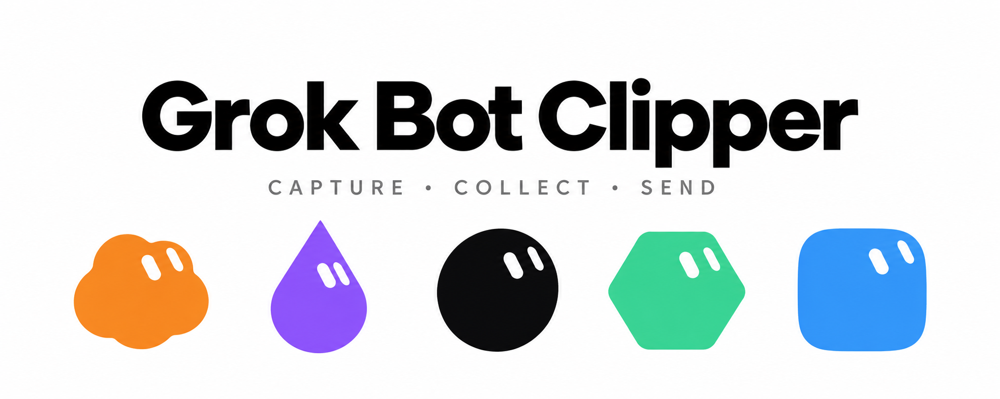

<p align="center">
  
</p>

<p align="center"><strong>Good things on the web. Straight to your BOT.</strong></p>
<p align="center"><em>Web clipping · Screenshots & files · Social sharing · Material basket · BOT conversations</em></p>

<p align="center">
  <a href="./README.md">English</a> · <a href="./README_ZH.md">中文</a>
</p>

<p align="center">
  <a href="LICENSE"></a>
  <a href="https://github.com/RongleCat/grok-bot-clipper/stargazers"></a>
  
  
  
</p>

<p align="center">
  <a href="https://x.com/cgnot996"></a>
  
  <a href="https://bot.tiezhu.si/"></a>
</p>

<p align="center">
  
</p>

<p align="center"><sub>By 铁柱AGI · Grok Bot learning site: <a href="https://bot.tiezhu.si/">bot.tiezhu.si</a></sub></p>

---

> [!NOTE]
> **Grok Bot Clipper is an unofficial browser extension for Grok Bot**, independently built by [铁柱AGI](https://x.com/cgnot996). It is not an official xAI or Cursor product. Connect your own Grok Bot account without a local connector, a project-operated relay server, or access to desktop-client credentials.

## What it does

| When you want to…                    | Use Clipper to…                                                                               |
| ------------------------------------ | --------------------------------------------------------------------------------------------- |
| Keep something useful from a page    | Capture selections, articles, links, images and tables with their sources                     |
| Capture content that is hard to copy | Take region, visible-page or long screenshots; crop, annotate and redact before sending       |
| Give a social post to a BOT          | Choose a recipient in X, Xiaohongshu and Douyin share areas, or the WeChat article author bar |
| Work with several sources            | Collect pages, screenshots and local files in a material basket and send one task             |
| Review before sending                | Edit the draft, add instructions and inspect the final text and attachments                   |
| Continue the discussion              | Read Markdown replies in the sidebar and send follow-up messages                              |

The **BOT picker** supports literal names, full pinyin and pinyin initials, with exact and prefix matches ranked first. Favorite frequently used BOTs, set a default recipient and refresh the roster manually.

**Social capture** preserves available titles, text, authors, tags, public engagement counts and media. It can retrieve and download complete video files from supported platform data, but availability depends on each page and response. Missing fields are reported, never filled with invented zeroes; covers are not presented as video files.

## Install from source

Requires Node.js **22.13+**, npm and a working Grok Bot account. This repository currently distributes source code; automated builds, package publishing and releases are not configured.

```sh
git clone https://github.com/RongleCat/grok-bot-clipper.git
cd grok-bot-clipper
npm ci
npm run build
```

**Chrome / Edge**

1. Open `chrome://extensions` or `edge://extensions`.
2. Enable **Developer mode** and choose **Load unpacked**.
3. Select the project's `dist/` directory.
4. Pin **Grok Bot Clipper**, open it and authorize your own account.
5. Choose a BOT, capture material and send it.

**Firefox desktop 140+**

```sh
npm run build:firefox
```

Open `about:debugging#/runtime/this-firefox`, choose **Load Temporary Add-on**, and select `dist-firefox/manifest.json`. Temporary installations expire when Firefox restarts. Permanent installation in standard Firefox requires Mozilla signing. See the [Firefox guide, in Chinese](docs/firefox.md).

After updating the source, rebuild and reload the extension in your browser's extension manager. Refresh any social pages that were already open. Chrome and Firefox builds use separate output directories.

## A few useful distinctions

- **Material basket**: collect pages, selections, images and files before combining them.
- **Drafts**: unsent material packages and instructions that you can keep editing.
- **Send preview**: inspect the final text and attachments without sending.
- **Send history**: check upload and delivery states and failure details.
- **BOT conversations**: read replies and continue the conversation.

With the pre-send instruction option disabled, selecting a BOT queues the material directly. When enabled, you can add instructions first. An accepted delivery means the server acknowledged the message, not that the BOT has finished the task.

## Keyboard shortcuts

| Action           | macOS   | Windows / Linux |
| ---------------- | ------- | --------------- |
| Capture a region | `⌘ ⇧ 7` | `Ctrl Shift 7`  |
| Save the page    | `⌘ ⇧ 8` | `Ctrl Shift 8`  |
| Quick command    | `⌘ ⇧ 9` | `Ctrl Shift 9`  |

Browser and OS conflicts can prevent a shortcut from being assigned; customize it in the browser's extension shortcut settings. In the instruction editor, `Enter` sends and `Shift+Enter` inserts a line break. IME confirmation does not send.

## What your BOT receives

Packages contain numbered sources, Markdown text, available author and capture metadata, original media attachments, and a `context.json` mapping sources to files. Social posts also include a `post-context.json` with engagement data and capture completeness.

When text exceeds the message budget, the message contains an index and excerpts while the complete text remains attached. Missing content caused by browser limits, lazy loading, cross-origin frames or restricted media is documented. Chrome can include an MHTML page snapshot; Firefox uses a body-HTML archive.

## Data and permissions

- Authorize your own account in the browser; desktop credentials are not read.
- Credentials live in extension-session storage by default. Persistent login is optional.
- Settings, drafts, materials and send history stay in the current browser and do not automatically sync between browsers.
- No analytics or project-operated relay service. Sending uploads material to the cloud service used by your selected BOT.
- Cross-site capture requests permissions when needed; built-in social integrations and upload hosts use fixed permissions.
- MHTML is a raw browser snapshot and may include signed-in or hidden page content. Disable it in settings or remove it from a draft.

See the [detailed technical guide, in Chinese](docs/technical-guide_ZH.md) for budgets, upload recovery and platform limits.

## Development

```sh
npm test                 # Automated regression tests
npm run build            # Chrome / Edge → dist/
npm run build:firefox    # Firefox → dist-firefox/
npm run lint:firefox     # Firefox extension checks
npm run test:fixture     # Local synthetic test page
```

Manual packaging scripts, `npm run package` and `npm run package:firefox`, remain available. No GitHub Actions build or automated binary-release workflow is configured.

| Directory            | Purpose                                                             |
| -------------------- | ------------------------------------------------------------------- |
| `src/content/`       | Page capture                                                        |
| `src/social/`        | Native sharing integrations, post normalization and media materials |
| `src/ui/`, `public/` | Panels, drafts, conversations and styles                            |
| `src/core/`          | Context packing, images, queues and local storage                   |
| `src/sdk/`           | Browser-side Grok Bot protocol client                               |
| `src/platform/`      | Chrome / Firefox compatibility                                      |

Tests cover protocol behavior, uploads, capture, context packing, pixel operations, browser adapters and UI interactions. jsdom tests are not real-browser end-to-end acceptance tests. [Historical verification notes, in Chinese](docs/verification.md).

## Grok projects and learning resources

| Project                                                                       | Purpose                                                                             |
| ----------------------------------------------------------------------------- | ----------------------------------------------------------------------------------- |
| [Grok Bot learning site](https://bot.tiezhu.si/)                              | Setup, usage, routines and practical examples                                       |
| [grok-bot-sdk](https://github.com/RongleCat/grok-bot-sdk)                     | Unofficial Grok Bot protocol SDK                                                    |
| [grok-bot-avatar-engine](https://github.com/RongleCat/grok-bot-avatar-engine) | Independent SVG avatar engine; different from this project's desktop avatar runtime |
| [Grok App](https://github.com/RongleCat/grok-app)                             | Desktop workbench for the Grok Build CLI                                            |
| [awesome-grok-bot](https://github.com/RongleCat/awesome-grok-bot)             | Bilingual collection of Grok Bot resources                                          |

## Author and community

- **X**: [@cgnot996 · 铁柱AGI](https://x.com/cgnot996)
- **WeChat official account**: search **铁柱AGI**, or scan the QR code at the top.
- **Learning site**: [bot.tiezhu.si](https://bot.tiezhu.si/)
- **Feedback and contributions**: [Issues](https://github.com/RongleCat/grok-bot-clipper/issues) · [Pull requests](https://github.com/RongleCat/grok-bot-clipper/pulls) · [Contributing](CONTRIBUTING.md)

## License and provenance

Project-owned code is available under the [MIT License](LICENSE). Third-party code and artwork retain their respective rights. **`vendor/desktop-avatar/` was extracted from the desktop application; it is excluded from this project's MIT grant, and no open-source license is claimed for it.** See [third-party notices](THIRD_PARTY_NOTICES.md) and [avatar provenance](vendor/desktop-avatar/PROVENANCE.md). This project does not grant rights to the Grok Bot brand or trademarks.
